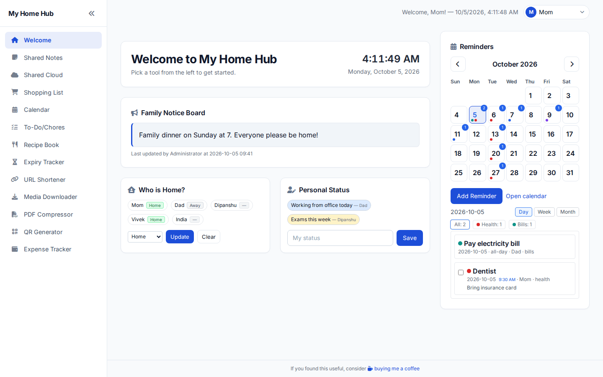

[](https://github.com/surajverma/homehub/actions/workflows/docker-publish.yml)

[](https://github.com/surajverma/homehub/commits/main)
[](https://github.com/surajverma/homehub/issues)
[](https://github.com/surajverma/homehub/issues?q=is%3Aissue+is%3Aclosed)
[](https://github.com/surajverma/homehub/stargazers)
[](https://github.com/surajverma/homehub/pkgs/container/homehub)

> **Maintainer Note**  
> Thank you for your interest in this project! I originally started it as a personal utility and never expected it to grow so quickly—I’m genuinely thrilled and grateful that it’s become helpful to you and your family.  
>  
> Please note that I am currently the sole maintainer and manage this repository alongside a full-time job, which means the time I can give to this project is somewhat limited. Responses to issues, pull requests, or questions may be delayed, especially during busy periods at work or at home.  
>  
> I typically work on the project after office hours or on weekends, depending on my availability and energy. Your patience, understanding, and support mean a lot—thank you for helping make this project better!

**Featured in:** [XDA Developers](https://www.xda-developers.com/self-hosted-dashboard-perfect-hub-for-your-familys-daily-needs/) · [DB Tech](https://dbtechreviews.com/2025/10/01/homehub-your-familys-private-self-hosted-home-organization-center/) ([video](https://www.youtube.com/watch?v=3IRvC1gs4mA)) · [selfh.st](https://selfh.st/post/wrapped-new-software-2025/)

# 🏡 HomeHub: Your All-In-One Family Dashboard

Ever wanted a simple, private spot on your home network for your family's daily stuff? That's HomeHub. It's a lightweight, self-hosted web app that turns any computer (even a Raspberry Pi!) into a central hub for shared notes, shopping lists, chores, a media downloader, and even a family expense tracker.

It’s designed to be easy to use for everyone in the family, with a clean interface that works great on any device.

## What Can It Do?

HomeHub is packed with useful tools to make family life a little more organized:

* **📝 Shared Notes**: A simple place to jot down quick notes for everyone to see.
* **☁️ Shared Cloud**: Easily upload and share files across your home network.
* **🛒 Shopping List**: A collaborative list so you never forget the milk again. Comes with suggestions based on your history!
* **✅ Chore Tracker**: A simple to-do list for household tasks.
* **🗓️ Calendar & Reminders**: A shared calendar to keep track of important dates.
* **👋 Who's Home?**: See at a glance who is currently home.
* **💰 Expense Tracker**: A powerful tool to track family spending, with support for recurring bills like newspapers, milk, or subscriptions. Set monthly budgets (overall and per category) and see charts of spending by category, by person and by day. Export a month or a date range as a CSV file for Excel or Google Sheets, and import expenses from a CSV file (HomeHub's own export or a bank or UPI statement) with a preview that flags likely duplicates. Anyone can record an expense paid by anyone, but only the person who added it (or the admin) can edit or delete it.
* **🎬 Media Downloader**: Save videos or music from popular sites directly to your server.
* ...and more, including a **Recipe Book**, **Expiry Tracker**, **URL Shortener**, **PDF Compressor**, **Weather Updates** and **QR Code Generator**!

## Salient Features
* **Private & Self-Hosted**: All your data stays on your network. No cloud, no tracking.
* **Simple & Lightweight**: Runs smoothly on minimal hardware.
* **Family-Focused**: Designed to be intuitive for users of all technical skill levels.
* **Customizable**: Toggle features on or off and even change the color theme right from the `config.yml` file.

<picture>
  <source media="(prefers-color-scheme: dark)" srcset="docs/images/homehub-dark.gif">
  
</picture>

## Getting Started is Easy

The best way to run HomeHub is with Docker. It's quick and keeps everything tidy

1. First, copy the `config-example.yml` to `config.yml`. This is where you'll name your hub, add family members and choose which features to show. The settings at the bottom (site password, upload limit, colours, reminders, calendar feed, weather, theme) are optional: delete any you don't need and HomeHub uses its defaults.
<details>
  <summary>Click to see an example config.yml</summary>


```yaml
# HomeHub settings
#
# Copy this file to config.yml and edit it. Changes are usually picked up on the next
# page load; if one is not, restart HomeHub (docker compose restart homehub).
# Quotes are optional, also around hex colours such as #2563eb.
# Everything below "OPTIONAL" can be deleted: HomeHub uses the default shown for it.

# ---------------------------------------------------------------------------
# BASICS
# ---------------------------------------------------------------------------

instance_name: "My Home Hub" # shown in the sidebar and the browser tab

# UI language for the whole household: a code from "Supported languages" in the README.
# Anything else falls back to English.
language: en

# The admin manages settings, budgets and backups. To protect it with a password, run:
#   docker exec -it homehub flask set-admin-password
admin_name: "Administrator"

# Everyone in the household, as they appear in the user picker, splits and chores.
# To give someone their own chart colour, see "Colours" under OPTIONAL.
family_members:
  - Mom
  - Dad
  - Dipanshu
  - Vivek
  - India

# ---------------------------------------------------------------------------
# FEATURES
# ---------------------------------------------------------------------------

# true shows a feature, false hides it. Keep every line: for most features a missing
# line counts as false (calendar, expense_tracker, who_is_home and personal_status are
# the exceptions and stay on).
feature_toggles:
  notes: true
  shared_cloud: true # shared file uploads
  shopping_list: true
  calendar: true
  chores: true # to-do list and chores
  recipes: true
  expiry_tracker: true
  url_shortener: false
  media_downloader: true
  pdf_compressor: true
  qr_generator: true
  expense_tracker: true
  who_is_home: true # Welcome page: who is home right now
  personal_status: true # Welcome page: a short status per person

# ---------------------------------------------------------------------------
# OPTIONAL: delete any block you do not need
# ---------------------------------------------------------------------------

# Site password, asked once per browser. Without it (or left empty) anyone on your
# network can open HomeHub.
password: ""

# Largest upload (Shared Cloud, PDFs) in MB. 0 removes the limit. Default: 1024.
max_upload_mb: 1024

# Colours for people in the expense charts: a colour name (teal, red) or hex.
# Without one, each person gets a colour from the default palette by their place in
# family_members, and the admin comes after the family. To pick one, write that person
# in family_members as a name with a colour:
#   family_members:
#     - Mom
#     - name: Dad
#       color: "#7c3aed"
# admin_color: "#0d9488"

# Reminders and calendar. Without this block: 12-hour times, weeks starting on Sunday,
# and reminders without categories.
reminders:
  time_format: 12h # 12h or 24h
  calendar_start_day: sunday # a weekday name (sunday to saturday) or 0-6, where 0 is Sunday
  # Categories to pick from when adding a reminder. key: short id (lowercase, no spaces),
  # label: the name shown, color: a colour name or hex.
  categories:
    - key: health
      label: Health
      color: "#dc2626"
    - key: bills
      label: Bills
      color: "#0d9488"
    - key: school
      label: School
      color: "#7c3aed"
    - key: family
      label: Family
      color: "#2563eb"

# Calendar subscription feed: lets calendar apps (Apple Calendar, Outlook, Thunderbird,
# ICSx5 on Android) show HomeHub reminders. Read-only; nothing is sent to any calendar.
# Off while the token is empty. Set a long random string (at least 16 characters), e.g. from
#   python -c "import secrets; print(secrets.token_urlsafe(32))"
# then subscribe to http://<your-homehub>/calendar.ics?token=<token>
# Anyone with the link can read your reminders. Change the token to revoke old links;
# it takes effect without a restart. Times use the container's TZ setting.
calendar_feed:
  token: ""

# Weather widget on the Welcome page (Open-Meteo, no account needed). Off unless enabled.
weather:
  enabled: false
  label: "" # place name shown on the widget; empty hides it
  latitude: "" # empty: use the browser's location
  longitude: "" # empty: use the browser's location
  timezone: "" # e.g. "Asia/Kolkata" or "America/New_York"; empty: detected automatically
  units: metric # metric or imperial
  view: compact # compact, or detailed (adds today's sunrise, sunset, UV, rain chance, high and low)

# Colours of the app. Without this block HomeHub uses its default blue look.
# The README "Theming" section lists every key.
theme:
  primary_color: "#1d4ed8"
```

</details>

**2. Run with Docker Compose**

Use the provided `compose.yml` file to get started in seconds:

```yaml
# compose.yml
services:
  homehub:
    container_name: homehub
    image: ghcr.io/surajverma/homehub:latest
    restart: unless-stopped
    ports:
      - "5000:5000" #app listens internally on port 5000
    volumes:
      - ./uploads:/app/uploads
      - ./media:/app/media
      - ./pdfs:/app/pdfs
      - ./data:/app/data
      - ./config.yml:/app/config.yml:ro
    environment:
      - SECRET_KEY=${SECRET_KEY:-} # optional, from .env; left empty, a key is generated once and kept in data/secret_key
      # - TZ=Asia/Kolkata # optional; see "Timezone" below
```

```bash
docker compose up -d
```
That's it! Open your browser and head to [http://localhost:5000](http://localhost:5000)

## Admin password (optional)

By default anyone can pick the admin user from the user switcher. To protect it, the server owner can set an admin password from the host:

```bash
docker exec -it homehub flask set-admin-password
```

- You are asked to type the password twice. Only a salted hash is stored, in `data/app.db`; nothing is written to `config.yml`.
- Once set, switching to the admin user asks for the password. Family members keep switching freely.
- The [Backups page](#backup-and-restore) is only available once an admin password is set.
- Run the same command again to change it. A forgotten password is fixed the same way.
- `docker exec -it homehub flask set-admin-password --clear` removes it and restores the default behaviour.
- Not using Docker? Run `flask set-admin-password` from the project folder.

The `password` in `config.yml` is separate: it protects the whole site and keeps working as before. You write it in `config.yml` as plain text; HomeHub only keeps a salted hash of it in memory, and after 5 wrong attempts the login form makes that device wait a minute, like the admin password prompt.

Logins and admin unlocks survive a restart: if `SECRET_KEY` is not set, HomeHub generates one on first start and keeps it in `data/secret_key`.

## Backup and restore

Backups are zip files kept on the server in `data/backups/` (on the host through the `./data` volume). The Backups page and the `flask backup` command save to the same folder and see the same list. A backup only protects you once it is copied to another device, so download it or copy it off the machine.

**From the browser:** set an [admin password](#admin-password-optional) first; backups hold everyone's data and may contain the site password, so the Backups page stays off without one. Then, as the unlocked admin, open **Manage backups** on the Welcome page.

- **Create a backup:** tick what to include. Each part shows its size, with a running total. The database and settings are always included. Downloaded media is off by default because it can be very large, and the page warns above about 1 GB. The backup is built in the background, so you can leave the page.
- **Download** any backup in the list (an interrupted download can resume), then **delete** it to free up space on the server.
- **Restore from a backup file:** choose a backup zip and you go straight to the restore page. It asks for the admin password again; you see what the backup holds and can untick parts. The uploaded zip is deleted from the server once the restore is done or cancelled. Uploads are limited by `max_upload_mb` (and by any reverse proxy in front of HomeHub); raise that for a bigger backup, or use `flask restore` below.
- **Safety backups:** before a restore replaces anything, the current data is saved as a safety backup in the list. It is the undo for that restore, so it is the one kind of backup with a **Restore** button there. The newest 3 are kept; older ones are deleted automatically.
- Restart HomeHub after a restore (`docker compose restart homehub`).
- `config.yml` is never overwritten, because it is mounted read-only. After a restore, the page shows the backup's config (passwords hidden) and saves it as `data/config-from-backup.yml`; copy the settings you want into `config.yml` yourself.

Backups that include `config.yml` may contain the site password in plain text. Keep them somewhere safe.

**From the host** (works with or without an admin password):

```bash
docker exec -it homehub flask backup                      # database, uploads, PDFs and config.yml
docker exec -it homehub flask backup --include-media      # media too
docker exec -it homehub flask restore /app/data/backups/homehub-backup-YYYYMMDD-HHMMSS.zip
docker compose restart homehub
```

- `--no-config` leaves `config.yml` out, and `--output PATH` writes the zip somewhere else inside the container.
- `flask restore` checks the zip, asks you to confirm (`--yes` skips the question), saves a safety backup and prints its path, restores everything in the zip, and runs database upgrades. As in the browser, the backup's `config.yml` goes to `data/config-from-backup.yml`.
- Not using Docker? Run `flask backup` and `flask restore PATH` from the project folder.

## Timezone (optional)

HomeHub decides what "today" is (due dates, overdue chores, recurring expenses and chores) and which time to show next to "By … at …" from the container's clock, which is UTC by default. If you are far from UTC, "today" can roll over a few hours early or late. Set your timezone with `TZ` in `compose.yml`:

```yaml
    environment:
      - TZ=Asia/Kolkata
```

Use a name from the [tz database](https://en.wikipedia.org/wiki/List_of_tz_database_time_zones), then run `docker compose up -d`. Leaving it out keeps the old UTC behaviour.

## Calendar subscription (optional)

HomeHub can publish your reminders as a read-only calendar feed (`.ics`), so they show up in Apple Calendar, Outlook, Thunderbird or your phone next to your other events. It only goes one way: HomeHub never reads from or writes to any other calendar. The feed holds reminders (one-time and recurring) from 60 days ago to a year ahead. Chores and expenses aren't included.

**Turn it on.** Make a long random token:

```bash
python -c "import secrets; print(secrets.token_urlsafe(32))"
```

and put it in `config.yml`:

```yaml
calendar_feed:
  token: "paste-the-token-here"   # at least 16 characters; empty turns the feed off
```

No restart is needed. Your link is:

```
http://<your-homehub-address>:<port>/calendar.ics?token=<token>
```

It works with or without a site password, because calendar apps can't log in. The token is what protects it. A wrong or missing token gets a plain "not found".

**Subscribe** (use "subscribe" or "from URL", not "import", so changes keep coming in):

- **Apple Calendar** (Mac): File → New Calendar Subscription, paste the link. On iPhone or iPad: Settings → Calendar → Accounts → Add Account → Other → Add Subscribed Calendar.
- **Outlook** (desktop): Add calendar → From internet (in classic Outlook: Home → Add Calendar → From Internet), paste the link.
- **Thunderbird**: Calendar → New Calendar → On the Network, paste the link as the location (format iCalendar/ICS).
- **Android**: install [ICSx⁵](https://icsx5.bitfire.at/), add a subscription with the link. The events then show in the Google Calendar app (and any other calendar app) on that phone. The phone fetches the feed itself, so this works at home or over a VPN such as Tailscale, with no internet exposure needed.
- **Google Calendar** (web: Other calendars → From URL): Google fetches the feed from Google's servers, not from your device, so **it only works if HomeHub is reachable from the internet** (for example through a Cloudflare Tunnel or a reverse proxy). Google also refreshes slowly, often only every 12-24 hours. If HomeHub stays on your home network, use ICSx⁵ on Android instead.

Apps are asked to refresh about every hour, but each app decides for itself how often it does.

**Times.** Reminders with a time use the container's `TZ` (see [Timezone](#timezone-optional) above). Without `TZ`, timed reminders are sent as "floating" times, which calendar apps show at the same clock time in whatever zone the device is in. Reminders without a time show as all-day events, and a timed reminder without an end lasts 30 minutes.

**Keep the link secret.** Anyone who has it can read your reminders, including their descriptions and who added them. The link also appears in HomeHub's access log (`docker logs`) and in the logs of any proxy in front of it. If it leaks, change the token in `config.yml`: old links stop working straight away, and every device needs the new link.

## Language

HomeHub can show its interface in another language. Set it for the whole household in `config.yml`:

```yaml
language: hi # a code from the table below
```

The change applies on the next page load, no restart needed. A missing or unknown value falls back to English, and so does any text that has no translation yet. What you type into HomeHub (notes, chores, names) is never translated.

### Supported languages

| Code | Language | Extra font |
| --- | --- | --- |
| `en` | English (default) | |
| `hi` | Hindi (हिन्दी) | Noto Sans Devanagari |
| `zh` | Chinese, Simplified (简体中文) | Noto Sans SC |
| `tr` | Turkish (Türkçe) | |

This table is the one place to list a new language. Translations are added by the community, so coverage can vary.

### Translating HomeHub

Each language is one file, `translations/<code>/LC_MESSAGES/messages.po`, covering both the pages and the page scripts. To add a language (Marathi, `mr`, as the example):

1. Create the file. This sets up the folder and the right plural rules for the language:
   ```bash
   pybabel init -i translations/messages.pot -d translations -l mr --no-wrap
   ```
2. Fill in each `msgstr` in `translations/mr/LC_MESSAGES/messages.po`. Any text editor works; [Poedit](https://poedit.net/) makes it easier. Keep placeholders such as `%(name)s` and `{count}` exactly as they are.
3. Set `language: mr` in `config.yml` and rebuild with `docker compose up -d --build`.
4. Add a row for the language to the [Supported languages](#supported-languages) table.
5. Only if the language is not written in Latin, Cyrillic or Greek script (which the Inter font already covers), add its Noto font from [Google Fonts](https://fonts.google.com/noto) to `LANGUAGE_FONTS` in `app/i18n.py`, for example `'mr': 'Noto Sans Devanagari'`, and name it in the table's Extra font column. French, German, Spanish or Russian need nothing here; Devanagari, Chinese, Japanese, Korean, Thai, Tamil or Bengali do. The font loads only when that language is selected.

Good to know:
- Anything left untranslated shows in English, so a partial translation is welcome.
- Month and weekday names come from the language automatically.
- Right-to-left languages are not supported yet: the text would translate, but the layout is not mirrored.
- Translations are built into the Docker image; the compiled `.mo` files are not kept in git.

Sending a translation: a pull request for a language should only change that language's file under `translations/`, add its row to the Supported languages table and, if step 5 applies, add the font line. There is no need to touch `config-example.yml` or the config sample above. The tests check that placeholders are intact and that nothing like links or HTML has been added. A review from a second native speaker is very welcome.

<details>
  <summary>For developers: marking and updating text</summary>

In templates and Python, wrap text in `_()` (`ngettext()` for counts). Page scripts in `static/js` use `t('text', {params})`, `th()` when the result goes into an HTML string, `tn(one, other, count)` for counts and `tc('context', 'text')` when one English word needs different translations. A sentence with a name, number or link in it is always one string with a placeholder, so each language can put the value where its grammar needs it.

```bash
# After adding or changing text: collect the strings and bring every language file up to date
flask translations update
# Compile for a local (non-Docker) run
flask translations compile
```

</details>

## Theming

HomeHub follows your system dark/light mode. You can customize colors via `config.yml > theme`.

Configurable keys (all optional):

```yaml
theme:
  # Accent colors
  primary_color: "#1d4ed8"
  secondary_color: "#a0aec0"
  # Surfaces & text
  background_color: "#f8fafc"
  card_background_color: "#ffffff"
  text_color: "#0f172a"
  # Sidebar palette. Leave these out for the default light sidebar.
  # Setting sidebar_background_color gives a coloured sidebar with light links.
  sidebar_background_color: "#2563eb"
  sidebar_text_color: "#ffffff"                # text color used for the sidebar title and labels
  sidebar_link_color: "rgba(255,255,255,0.95)" # link text color in sidebar items
  sidebar_link_border_color: "rgba(255,255,255,0.18)" # subtle border around sidebar links
  sidebar_active_color: "#3b82f6"              # background of the current page's link
```

Tips:
- Hex colours work with or without quotes (`primary_color: #1d4ed8` is fine).
- The old default blue sidebar (`#2563eb`) is treated as "not set", so configs copied from an older `config-example.yml` get the new light sidebar. Pick any other colour to keep a coloured sidebar.
- Prefer lighter/darker accents? Tweak `primary_color` and `secondary_color`.
- Dark mode palette adapts automatically; the variables above apply to light mode, while dark mode uses tuned counterparts for good contrast.

### Colours for people in the expense charts

Each person gets a chart colour from a fixed palette, by their position in `family_members` (the admin comes after the family). To pick a colour yourself, write that person as a `name` with a `color`; plain names keep working, and the admin's colour goes in `admin_color`:

```yaml
admin_name: "Administrator"
admin_color: "#0d9488"

family_members:
  - Mom
  - name: Dad
    color: "#7c3aed"
  - name: Dipanshu
    color: red
```

- Use a colour name (`red`, `teal`, `RoyalBlue`: any CSS colour name) or a hex colour (`#7c3aed` or `#73d`), with or without quotes. Anything else is ignored with a warning in the log, and that person keeps the default.
- People without a colour keep the one they had, so picking a colour for one person never changes anyone else's.
- HomeHub adjusts a colour only when it would be hard to see: a very pale one is darkened a little on the light cards, a very dark one is lightened a little on the dark cards. Everything else is used as written.
- Nothing stops two people from looking alike: if you pick a colour close to someone else's default (blue for Dad while Mom is blue by position), give Mom a colour too.
- Restart HomeHub (or save `config.yml`; it is re-read when it changes) and reload the page.

## Weather Widget

HomeHub includes an optional weather widget powered by [Open-Meteo](https://open-meteo.com/), a free weather API. The widget displays current weather conditions and optionally today's forecast on your dashboard.

**By default, the weather widget is hidden.** You can enable it through `config.yml`:

```yaml
weather:
  enabled: true # set to true to show the widget
  label: "" # optional location label (e.g., "Kolkata"). Leave blank to hide.
  latitude: "" # optional, leave empty to use browser geolocation
  longitude: "" # optional, leave empty to use browser geolocation
  timezone: "" # optional, e.g., "Asia/Kolkata" or "America/New_York"; if unset, API uses timezone=auto
  units: metric # metric or imperial (default: metric)
  view: compact # compact or detailed (detailed shows today's forecast: sunrise, sunset, UV, rain %, highs/lows)
```

**Features:**
- **Two view modes:**
  - `compact`: Shows current temperature, weather condition, feels like, wind (with direction and gusts), humidity, and recent precipitation
  - `detailed`: Adds today's forecast with sunrise/sunset times, UV index, precipitation probability, and daily high/low temperatures
- **Smart caching:** Weather data is cached for 15 minutes to respect API rate limits and improve performance
- **Flexible location:** Use configured coordinates or browser geolocation
- **Timezone support:** Displays times in your configured timezone, or uses automatic detection
- **Unit selection:** Choose between metric (°C, km/h, mm) or imperial (°F, mph, mm) units

**Privacy Note:** When enabled, the widget makes API requests to Open-Meteo's servers. Please review [Open-Meteo's privacy policy](https://open-meteo.com/en/terms) for details on their data handling practices.

## Development Setup

To contribute or run & build HomeHub locally, follow these steps:

### 1. Clone the Repository
```bash
git clone https://github.com/surajverma/homehub.git
cd homehub
```

### 2. Python Environment Setup
```bash
python -m venv venv
venv\Scripts\activate  # On Windows
pip install -r requirements-dev.txt  # the app's packages plus pytest
```

### 3. Configuration
- Copy `config-example.yml` to `config.yml` and edit as needed for your family, features, and theme.

### 4. CSS Build (Tailwind + Custom Styles)
```bash
npm install
npm run build:css
```
- For live CSS rebuilds during development:
```bash
npm run watch:css
```

### 5. Running the App
- **With Docker (recommended):**
  ```bash
  docker compose up -d
  ```
- **Locally (for development):**
  ```bash
  python run.py
  ```
  (Ensure you have built CSS and set up your config.) Set `FLASK_DEBUG=1` to get auto-reload and Flask's debugger; it is off by default.

### 6. Troubleshooting
- If you see missing dependency errors, ensure you have run both `pip install -r requirements-dev.txt` and `npm install`.
- If port 5000 is in use, stop the conflicting service or change the port in `compose.yml` and `config.yml`.
- For Docker issues, try `docker compose down` then `docker compose up -d`.
- If the log says `config.yml is missing` or `config.yml is a folder`, HomeHub is running on the defaults from `config-example.yml`. Docker creates an empty `config.yml` folder when the file is not there at first start: remove that folder, copy `config-example.yml` to `config.yml`, and start the container again.
- `docker ps` shows the container as `healthy` once the app answers on `/healthz`.
- The database runs in SQLite's WAL mode. If `data/` sits on a network share (NFS, SMB) and you see `database is locked` or disk I/O errors, add `- SQLITE_JOURNAL_MODE=DELETE` under `environment:` to go back to the previous mode.

### Supported platforms
The Docker image is built for `linux/amd64` and `linux/arm64`, which includes a Raspberry Pi 4 or 5 running a 64-bit OS. 32-bit ARM (`linux/arm/v7`, e.g. 32-bit Raspberry Pi OS) is no longer built: stay on the last image you pulled, or move to a 64-bit OS to keep getting updates.


## License

This project is licensed under the MIT License. See the [LICENSE](LICENSE) file for details.

## Contributing

Contributions are always welcome! If you have any ideas, suggestions, or bug reports, please open an issue or submit a pull request.

## Disclaimer & Security Notice

This software is being provided to the community "as is." This means it comes **without any warranty or guarantee of any kind.** While I've done my best to build it, I can't promise it will be perfect, fit your exact needs, or be 100% free of bugs.

**Please be aware that you are using this software at your own risk.** The authors and contributors are not responsible for any problems, damages, or data loss that might occur from using it.

### 🛡️ Important Security Notice

This project is built for use on a **local or trusted network** (like your home).

It is **not designed or hardened to be safely exposed to the public internet.** If you choose to host this software publicly, you are solely responsible for performing a full security review and adding the necessary protections before you do so.

### 🌤️ Weather Data & Third-Party Services

The optional weather widget uses [Open-Meteo](https://open-meteo.com/), a free weather API service. When the weather widget is enabled:
- Your browser makes requests to Open-Meteo's servers to fetch weather data
- Location coordinates (latitude/longitude) are sent to their API
- Open-Meteo has its own [privacy policy](https://open-meteo.com/en/terms) and terms of service

By enabling the weather widget, you acknowledge that weather data is provided by a third-party service and is subject to their policies. HomeHub itself does not store or process weather data beyond local browser caching.

## Have Fun!

This project was built to be a practical tool for my own family, and I hope it's useful for yours too.

If you find HomeHub useful, you can [buy me a coffee ☕](https://ko-fi.com/skv).
